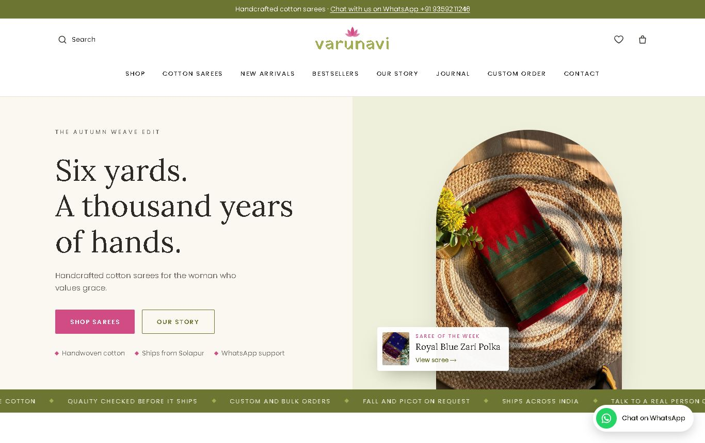
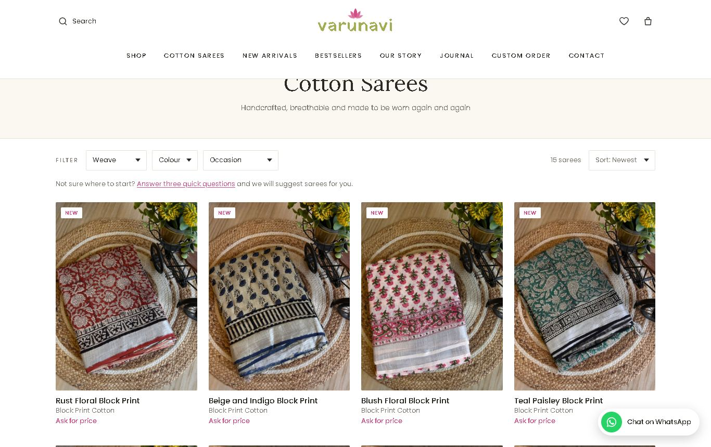
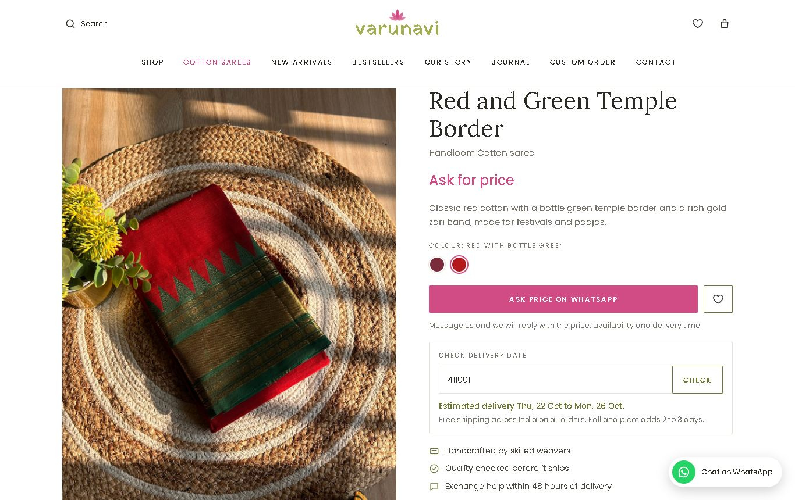
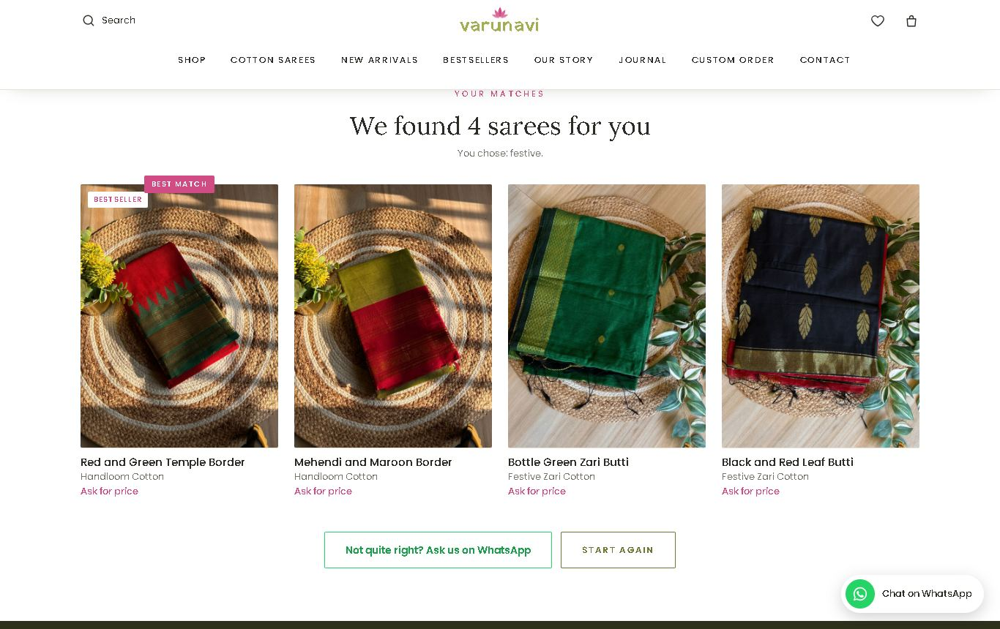
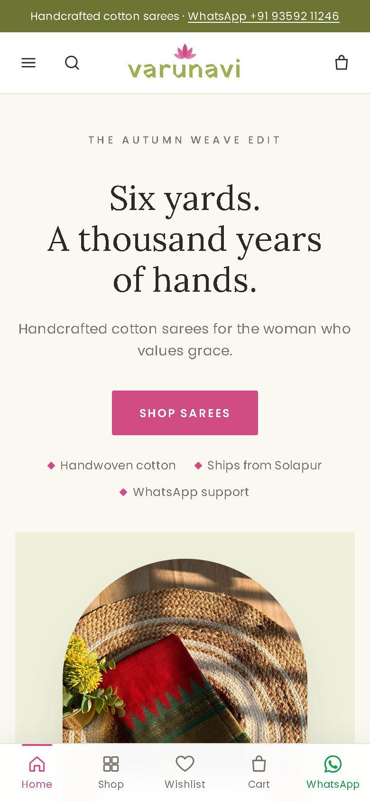
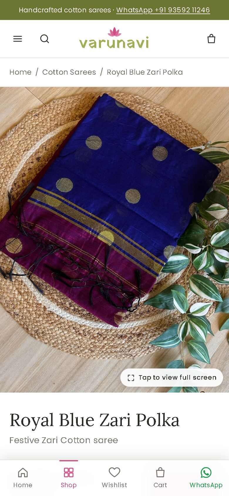
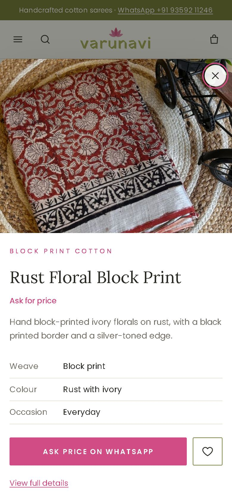

# Varunavi Vastra website (Next.js)

Online store for Varunavi Vastra handcrafted cotton sarees from Solapur, built with Next.js and React. `npm run build` turns it into plain static files in `out/`, so it can be hosted on Netlify without a server.

**Live site:** https://varunavi-vastra.netlify.app



## Screenshots

| Shop | Saree page |
| --- | --- |
|  |  |

| Help me choose (saree finder) |
| --- |
|  |

**On phones**

| Homepage | Saree page | Quick view |
| --- | --- | --- |
|  |  |  |

## Features

- **Shop:** filter by collection, colour, occasion and price; sort by newest, popular or price; "Load more"; a slide-up filter panel on phones.
- **Saree pages:** photo gallery with zoom and full-screen view, colour swatches linking related sarees, delivery date estimate by pincode, fall and picot add-on, share button, reviews, "You may also like" and "Recently viewed".
- **Ordering through WhatsApp:** sarees without a price show "Ask price on WhatsApp". The cart sends the full order (with address, gift note and discount code) as a WhatsApp message, with optional UPI payment by QR code or UPI app.
- **Help me choose:** three questions (occasion, colour, style) and the best-matching sarees.
- **Quick view, wishlist and search:** quick view pop-up on cards; wishlist with "Ask about all on WhatsApp" and sharing; search with live results, popular and recent searches.
- **Homepage:** shop by weave, occasion and colour, new arrivals, bestsellers, saree of the week, the founders' story, Instagram grid, journal.
- **Content:** Our Story, Journal (care and draping guides), Custom Order and Contact forms (sent to WhatsApp), with an "Open now" sign and directions; FAQ, shipping, refund, privacy and terms pages.
- **Phones:** app-style bottom bar (Home, Shop, Wishlist, Cart, WhatsApp) and a sticky "Ask price" bar on saree pages.
- **Search engines:** a pre-built page for every saree and article, product data for Google, `sitemap.xml` and `robots.txt`.

To refresh these screenshots after a change, take new ones of the same pages and save them over the files in `docs/screenshots/`.

## Run locally

Open a terminal in this folder (`D:\varunavi-vastra`), then:

| Command | What it does |
| --- | --- |
| `npm install` | First time only: downloads the libraries the site needs |
| `npm run dev` | Starts the site at http://localhost:3000 and reloads as you edit. Stop it with Ctrl+C |
| `npm run build` | Makes the finished site in `out/` (also prepares new photos) |
| `npm start` | Shows the finished `out/` site at http://localhost:3000, exactly as it will be published |
| `npm run photos` | Only prepares new photos from `photos/` |

## Vercel

`vercel.json` holds the Vercel settings (build command, `out` folder, redirects for old links). To publish there the first time:

```
npx vercel login
npx vercel deploy --prod
```

Answer the questions with the defaults (team "vishalkondi-team", project name "varunavi-vastra").

## Publish

Live at https://varunavi-vastra.netlify.app (Netlify project "varunavi-vastra"). Code on GitHub: https://github.com/Vishalkondi/VARUNAVI-VASTRA-Store

To publish changes, run `npm run build`, then upload only the `out` folder. The whole project is too large for Netlify's upload, which fails with a "500" error. Either ask Claude to redeploy, or drag the `out` folder onto https://app.netlify.com/projects/varunavi-vastra/deploys.

To publish automatically instead, link the GitHub repository in Netlify (Site configuration → Build & deploy → Link repository). Netlify then runs `npm run build` and publishes `out/` on every push, using the settings in `netlify.toml`.

The previous plain-HTML version of the site is kept in `old-html-site/` for reference. It is not used or published.

`netlify.toml` also redirects old links such as `product.html?id=indigo-ikat` to the new `/product/indigo-ikat`, so links people have already shared keep working.

## Everyday edits — `lib/data.ts`

Everything that used to be in `assets/js/products.js` is now in this file. It works the same way:

- **Contact details, Instagram/Facebook links, logo, saree of the week, UPI, discount codes, fall and picot price, top bar message, opening hours (`openDays`, `openTime`, `closeTime`) and delivery times (`delivery`):** the `SITE` block at the top.
- **Add or edit a saree:** copy one entry in `PRODUCTS` and change its fields. Use a unique `id`, which becomes the product page address (`/product/<id>`).
- **Photos:** put the full-size phone photo in `photos/`, named after the saree's `id` (for example `photos/rust-floral-block-print.jpg`), and list it in that saree's `images: [...]` as `"assets/images/products/rust-floral-block-print.jpg"`. The build makes a 1200×1600 copy for the product page and a 600×800 copy for cards in `public/assets/images/products/`, cropped from the centre to the 3:4 shape (run `npm run photos` to make them without building). Keep the saree in the middle of the shot. Your original photos stay in `photos/` and are never uploaded.
- **Real logo:** save it as `public/assets/images/logo.png` and set `logoImage: "assets/images/logo.png"`.
- **Journal:** add articles to `POSTS`.

After an edit, run `npm run build` again and publish the new `out/` folder.

Placeholder photos for the hero, the story section and the founders are marked in the page files with `Replace with: ...` comments.

## Page addresses

| Old address | New address |
| --- | --- |
| `index.html` | `/` |
| `shop.html?weave=…&new=1&q=…` | `/shop?weave=…&new=1&q=…` |
| `product.html?id=…` | `/product/…` |
| `post.html?id=…` | `/journal/…` |
| `our-story.html`, `contact.html`, etc. | `/our-story`, `/contact`, etc. |

Every saree and journal post now gets its own pre-built page with its own title, description and product data for search engines. The old site filled these in with JavaScript after the page loaded.

## Files

```
app/                     One folder per page (page.tsx)
  layout.tsx             Fonts, header, footer, page titles
  globals.css            All styles (brand colours at the top)
  product/[id]/page.tsx  One page per saree
  journal/[id]/page.tsx  One page per article
components/
  Header.tsx, Footer.tsx Site header (menu, search, cart count) and footer
  Bits.tsx               Product cards, images, breadcrumbs, trust strip...
  Shop.tsx               Shop grid with filters and sorting
  Cart.tsx               Cart, discount codes, WhatsApp/UPI checkout
  ProductParts.tsx       Gallery, add to cart, share, recently viewed
  Forms.tsx              WhatsApp forms, newsletter, add-to-cart button
  Extras.tsx             Delivery date check, open/closed sign, wishlist actions, back to top
  Finder.tsx             "Help me choose" questions and results
  QuickView.tsx          Quick view pop-up on product cards
app/sitemap.ts, robots.ts   Build sitemap.xml and robots.txt for search engines
docs/screenshots/        Pictures used in this README
lib/
  data.ts                Store settings + catalogue  ← edit this
  store.ts               Cart, wishlist and recently viewed (saved in the browser)
  utils.ts               Prices, links, search
scripts/flatten-prefetch.mjs  Runs after build; fixes Next.js link-prefetch files for static hosting
```

## Before going live

- Fill in everything in `[brackets]` on the Our Story page and the policy pages.
- The newsletter form shows a thank-you message but doesn't save emails yet. Connect it to Mailchimp, Brevo or Formspree (see `NewsletterForm` in `components/Forms.tsx`).
